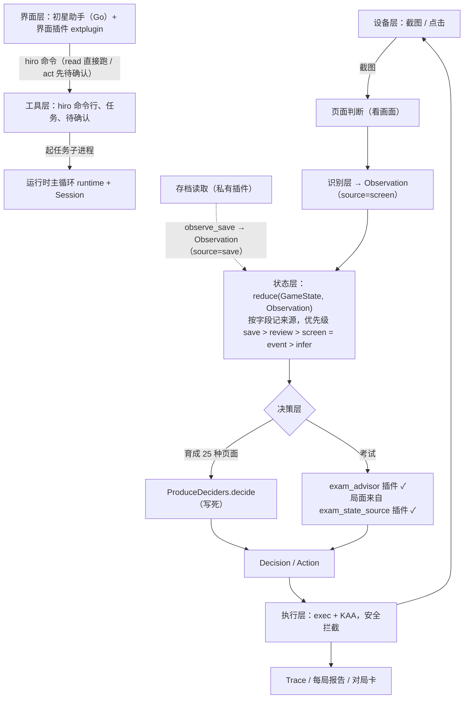
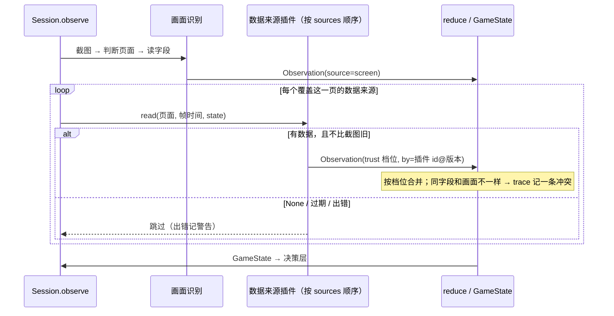

# hiro 插件架构设计：数据来源、打牌、育成都可替换

状态：2026-11-25 用户批准。讨论过程在 Ryugi 文档 `document/strategy-plugins`（见第 7 节）。

## 1. 要做什么、为什么

把 hiro 运行时里「拿数据」和「做决定」变成可替换的插件：像 hook 采集站这样不看画面也能拿到游戏数据的来源，像 UINet / GNRPA / GKMS 引擎这样更强的打法，都能作为独立的 Python 包接进来，不改主循环，也不用放进开源仓库。打牌已经能换（`exam_advisor`），这次补上数据来源和育成，并且让「这一局、这一步是谁定的」看得见。

**目标**

- 新增两种插件：数据来源 `observation_source`、育成 `produce_advisor`；同一种插件可以同时装多个，按 id 区分。
- 每个决策点（育成 25 种页面 + 考试出牌）单独指定用哪个插件，可以混用。
- 用一个配置文件和开局参数选用，不再靠手设环境变量；`hiro plugins list` 能查装了什么、能不能用。
- 每一步、每一局都记下用了哪个插件；用了隐藏信息的对局单独打标记。

**这次不做**

- 初星助手里装插件、选插件的界面（先给开发者用，接口给界面留好位置）。
- 影子模式（你定了装上就接管）。
- 任何具体插件的实现，包括 hook 采集站插件；只带一个测试用的示例插件。
- 设备层、OCR 后端的插件化；拆分现有的 5000 行决策器；`HIRO_STRATEGY`（整个 KAA 培育流程类）的替换方式不动。

**绝不做**

- 插件不能直接点击、不能直接改 `GameState`、不能绕过执行层的安全拦截（不花ジュエル、不按破棄、不点タイトルへ）。
- 开源仓库不放读存档、解密、种子还原代码。

## 2. 现在的架构（按代码和 AGENTS.md 核对过）



层与层之间只传 `src/hiro/contracts` 里的契约对象（现在版本 1.2）。Python 插件在 `src/hiro/plugins.py`，按「代码注册 > 环境变量 > 入口点 > 默认」选，每种插件只有一个实例。界面插件 `extplugin` 是另一套机制，碰不到运行时。

## 3. 已经定的

| 决定 | 谁定的 |
|---|---|
| 打牌、育成都做成插件；这次定架构和插件对外能力，不是接某个采集站 | 你 |
| 先给开发者用：入口点 + 配置文件 + 开局参数 + `hiro plugins list`，界面以后再加 | 你（第 1 题） |
| 数据来源给的画面上看不到的字段，实战也收；用过的对局打标记，战绩单独统计 | 你（第 2 题） |
| 考试局面并进统一的数据来源，旧的 `ExamStateSource` 接口留一层转接 | 你（第 3 题，同意推荐） |
| 数据来源和画面冲突时，按插件声明的可信档位合并，冲突写进 trace | 你（第 4 题，同意推荐） |
| 每个决策点单独选插件，可以混用 | 你（第 5 题） |
| 装上就接管，不做影子模式 | 你（第 6 题） |
| 数据来源产出 `Observation`，走现有 `reduce`，不另开通道 | 我的决定 |
| 页面判断留在画面上，数据来源只填字段 | 我的决定 |
| 育成插件从 `ProduceDeciders.decide` 开头接入，现有决策器原样当默认 | 我的决定 |
| 插件出错、超时、输出不合法：这一步退回默认实现，不停机，记下原因 | 我的决定 |

## 4. 设计

### 4.1 插件注册：同一种插件可以有多个

- `plugins.KINDS` 加两种：`observation_source`、`produce_advisor`。
- 入口点组仍是 `hiro_gakumas.plugins`。名字写 `<种类>`（老写法，等于这一种的默认实例）或 `<种类>.<插件 id>`（新写法，可以同时有多个）。
- 每个插件类带三个属性：`id`、`version`、`contracts`（它认的契约主版本，如 `"1"`）。主版本对不上就不加载，记成不可用。
- `plugins.get(kind)` 行为不变，现有调用方（素材、考试）不用改。新增 `plugins.get_by_id(kind, id)` 和 `plugins.available(kind)`：后者返回每个已装插件的 id、版本、来源（入口点 / 环境变量 / 代码注册）、能不能用、不能用的原因。加载失败不抛异常，记下原因。
- 内置实现的 id 统一叫 `builtin`，保留不给插件用。

### 4.2 选用：一个配置文件 + 开局参数

```json
// HIRO_HOME/strategy.json（不存在 = 全部用内置）
{
  "version": 1,
  "sources": ["gkms_hook"],                 // 数据来源，按列表顺序，同档位前面的优先
  "exam": "gnrpa_pro",                      // 考试出牌；可选 "exam.hif" / "exam.hajime" / "exam.nia" / "exam.tower" 按模式覆盖
  "produce": {                              // 育成：页面名 → 插件 id；没写的页面用内置
    "ACTION_SELECT": "uinet",
    "SELECT_CARD": "uinet",
    "SELECT_DRINK": "builtin"
  },
  "timeouts": { "uinet": 60 }               // 单步超时（秒），没写按默认
}
```

- **开局参数**：`run start` 加 `--plugin <决策点>=<id>`（可重复，如 `--plugin produce.ACTION_SELECT=uinet`）和 `--sources a,b`，只对这一局生效。
- **传给任务**：开局时把「配置文件 + 这局参数」合成一份，存进任务目录的 `strategy.json`，`child_env` 设 `HIRO_STRATEGY_FILE` 指过去；运行时只读这个文件。注意它和现有的 `HIRO_STRATEGY`（KAA 培育流程类）是两回事。
- **优先级**：开局参数 > `strategy.json` > 老的环境变量（`HIRO_EXAM_ADVISOR` 等，照旧生效）> 入口点里的老写法 > 内置。
- 不经过初星助手直接跑（`tools/play_game.py`、`run_hif`）时，设了 `HIRO_STRATEGY_FILE` 就读，没设就和现在完全一样。
- 配置里写了没装或不可用的插件：这一局照常开，对应决策点用内置，开局时写一条警告进日志和任务事件。

### 4.3 数据来源 observation_source

```python
class ObservationSource(Protocol):
    id: str
    version: str
    contracts: str
    trust: Literal["save", "screen", "infer"]  # 可信档位，决定和画面冲突时谁赢
    pages: frozenset[str] | None  # 能给哪些页面的数据；None = 全部

    def start(self, context: dict) -> None: ...  # 一局开始：模式、偶像卡、设备
    def read(self, page: str, frame_t: float, state: GameState) -> SourceRead | None: ...
    def stop(self) -> None: ...


@dataclass
class SourceRead:
    t: float  # 这份数据对应游戏里的时刻
    fields: dict[str, Any]  # 画面上看得到的字段，键必须在 FIELD_CATALOG[page] 里
    meta: dict[str, FieldMeta]  # 每个字段怎么来的
    hidden: dict[str, Any] = {}  # 画面上看不到的（牌库顺序、种子、事件结果…）
```



- **接入点**：`Session.observe`（`src/hiro/loop/session.py`）在画面那份 `Observation` 合并完以后，挨个问配置里的数据来源。`observe_save` 那条老路保留。
- **契约改动（升到 1.3，加字段不破坏）**：`Observation` 加 `by`（插件 id@版本）和 `hidden`；`Observation.source` 允许 `plugin`；`GameState.Source` 加 `by`；`GameState` 加 `hidden: dict`。`reduce` 用插件声明的 `trust` 当来源档位。
- **过期**：`SourceRead.t` 比这一帧截图时间早出容差（默认 0.5 秒，实现时按实测定）就丢掉。
- **字段校验**：`fields` 里不在 `FIELD_CATALOG[page]` 的键不收，记一条警告；画面看不到的东西只能放 `hidden`。
- **隐藏信息**：`hidden` 合并进 `GameState.hidden`，决策器和插件都能读。只要这一局收过任何非空的 `hidden`，就给这一局打上 `uses_hidden`（见 4.6）。
- **考试转接**：`src/hiro/exec/exam.py` 仍通过 `ExamStateSource` 接口拿局面。默认实现换成一个转接类：有数据来源覆盖 `HIF_EXAM` 且数据新鲜时，用它的字段（和 `hidden`）拼 `BattleState`，`confidence()` 按 `trust` 给 `save` 或 `screen`；否则原样交给原来选中的实现（`ScreenExamStateSource`、`SimScreenExamStateSource` 或私有存档插件），它们不用改。

### 4.4 打牌 exam_advisor

- 接口不改（`on_round_start / decide / on_round_end`）。
- 选用：`strategy.json` 的 `exam`，可按模式覆盖；没配时沿用现在的链（`HIRO_EXAM_ADVISOR` → 默认 `SearchAdvisor`）。偶像之路的 `HIRO_TOWER_ALGO` 不动，`exam.tower` 只决定用哪个 advisor。
- 出错、给出不在 `legal` 里的动作：沿用现在的处理（按规则重选，不退回第一个合法动作），另外记下是哪个插件出的错。

### 4.5 育成 produce_advisor

```python
class ProduceAdvisor(Protocol):
    id: str
    version: str
    contracts: str
    pages: frozenset[str]  # 能接哪些页面（必须是 decide 分派表里的页面名）

    def begin(self, context: dict) -> None: ...  # 一局开始：模式、难度、偶像卡、主属性、编成方案、攻略包
    def decide(self, page: str, state: GameState, *, n_options: int | None, kw: dict) -> Decision | None: ...
    def end(self, result: dict | None) -> None: ...


# ProduceDeciders.decide(page, state, n_options, **kw) 开头：
#   pid = 配置里这个页面对应的插件
#   if pid and page in plugin.pages:
#       d = 带超时调用 plugin.decide(...)
#       d 为 None → 往下走现有逻辑（这一步记「插件不管」）
#       出错 / 超时 / _invalid_decision(page, d, n_options, kw) 不为 None → 往下走现有逻辑，warnings 写明插件和原因
#       否则 d.plugin = "id@版本"，直接返回
#   现有逻辑一行不改
```

- **决策点**：就是 `ProduceDeciders.decide` 分派表里的 25 个页面名（ACTION_SELECT、SELECT_CARD、SELECT_DRINK、CONSULT、STUDY、OUTING、HIF_ROUND_INTERVAL、SELECT_PITEM、EVENT_CHOICE、EXAM_CARD_MOVE、PDRINK_MAX、PDRINK_MAX_CONFIRM、SPECIAL_GUIDANCE、FORMATION、TOWER_FORMATION、TOWER_RETRY、QUALIFY_MEMORY、SKILL_CARD_CHANGE_1、SKILL_CARD_CHANGE_2、SKILL_CARD_REMOVAL、SKILL_CARD_ENHANCE、NIA_SALES_PLACE、NIA_SALES_EVENT、NIA_AUDITION_SELECT、EXAM_RETRY）。以后分派表加页面，决策点跟着加。
- **合法性**：育成页面没有现成的「合法动作列表」，校验沿用 `_invalid_decision`，所以插件拿到的参数和它一样（`n_options`、`kw`）。
- **超时**：默认 60 秒一步（现有决策器里有调 LLM 的步骤，插件也可能调），可在 `strategy.json` 的 `timeouts` 里按插件改。
- **插件的内部状态**：`ProduceDeciders` 自己存着本局的状态（已拿的必拿卡、相談次数等）。插件接管某页时，这些状态不会替它更新；插件要自己管自己的状态，`begin` 时拿到本局上下文。
- **begin / end**：每局第一次用到这个插件时调 `begin`；整局结束（包括出错停下）时调 `end`，挂在运行时的收尾流程里。

### 4.6 看得见：每一步、每一局、查询命令

- **每一步**：`Decision` 加 `plugin` 字段（插件 id@版本，内置为空），`Decision.SOURCES` 加 `plugin`。trace 的每一步、任务事件流都带上。初星助手的来源标签（`app/labels` 的 `Source`）加一类「插件」，显示插件 id；这是界面上唯一要改的地方。
- **每一局**：`loop/manifest.py` 现在记 3 种插件的来源，扩成记下实际生效的整张对应表（数据来源列表、考试、每个育成决策点）和 `uses_hidden`。每局报告（`reports/runs/<trace>.json`）加 `plugins` 一节：每个决策点用了谁、插件定了几步、交回默认几步、出错几步；`uses_hidden` 和收到过哪些隐藏字段的名字。
- **隐藏信息的对局**：`uses_hidden` 为真的对局，在报告和复盘页标题上标明，战绩统计里单独一组，不和普通对局混在一起。
- **查询**：新增只读命令 `hiro plugins list`（agent 也能调）：每个已装插件的 id、版本、种类、能接的页面 / 档位、来源、能不能用、原因；再加当前 `strategy.json` 解析后的生效对应表。输出形状按以后界面要用的写。`hiro doctor` 加一项：配置里的插件都能加载、契约版本对得上。

### 4.7 出错处理（统一一条）

| 情况 | 处理 |
|---|---|
| 配置里的插件没装、加载失败、契约版本不对 | 开局照常，相关决策点用内置；日志、任务事件、报告各记一条 |
| 育成插件抛异常、超时、输出不合法 | 这一步走现有逻辑；`warnings` 写插件 id 和原因；报告里计入「出错」 |
| 育成插件返回 None | 这一步走现有逻辑，计入「交回默认」 |
| 数据来源抛异常、超时、数据过期、字段不合法 | 这次跳过这个来源（不合法的字段单独丢掉），记警告；画面读数照常 |
| 打牌插件出错 | 沿用现在 `exec/exam.py` 的处理，加记插件 id |

### 4.8 补充约定（审阅后我定的）

一个审阅者按「拿到文档就开工」读了一遍，提出 8 处要猜的地方。都不改变第 3 节的决定，我按最稳的做法定下：

1. **考试里的隐藏信息怎么到出招插件**：`BattleState` 加 `hidden` 字段，考试转接类把数据来源的 `hidden` 填进去，出招插件从 `state.hidden` 读。考试循环不是每帧都经过 `Session.observe`，所以转接类直接按配置问数据来源，自己按档位合并、自己记冲突（规则和 4.3 一样）。（我的决定）
2. **育成插件输出的校验**：`_invalid_decision` 只查 5 个页面，不够。给插件的输出另加一层「每页允许的动作类型」白名单（按内置决策器在各页实际会输出的动作类型整理），不在白名单里就当不合法、交回默认。内置决策器不走这层，行为不变。执行层的安全拦截照旧，这层是多一道保险。（我的决定）
3. **同一档位时谁赢**：插件声明的档位比画面高，就以插件为准；和画面同档位，画面已经读到的字段保留，插件只补画面没读到的。冲突按「同一帧、同一字段、值不同」记，不看档位。插件的 `Observation` 也走 `reduce_checked`，和画面读数受同样的互验和拦截。（我的决定）
4. **什么时候问数据来源**：只在 `Session.observe` 处理真截图（`source="screen"`、做了字段抽取、页面不是 unknown）时问；`frame_t` 用这张截图的时间。`fields=False`、`observe_save` 这些调用不问。（我的决定）
5. **「一局」的边界**：选拔、本战、续跑都是各自的进程和 trace 段，`begin` / `end` 按进程调；插件要跨段保留状态，自己存（`begin` 的上下文里给 trace 目录和任务目录）。`uses_hidden` 按 trace 段记；`play_game` 整局的汇总里，只要有一段用过就算用过。（我的决定）
6. **「战绩单独统计」这次做到哪**：仓库里还没有跨局的战绩汇总，这次只把标记写进 manifest、每局报告、任务摘要和复盘页标题；以后做汇总、对比（包括 benchmark）时按这个标记分组。（我的决定）
7. **考试的 `builtin` 指什么**：指现在整条链（`HIRO_EXAM_ADVISOR` → 默认 `SearchAdvisor` → 退回 bench 中转层，偶像之路走 `HIRO_TOWER_ALGO`），没配置时行为和现在完全一样。选了插件时，考试局面来源仍按现在的规则选（加上 4.3 的转接）；插件需要特定的局面来源（比如要模拟器预演），在它的说明里写明，由使用者配。（我的决定）
8. **`SourceRead.t` 的时间**：跑 hiro 那台机器的本机时间（epoch 秒）。数据来源在别的机器上时，换算由插件负责。数据比截图旧、或者比截图新出容差，都算对不上、丢掉：新太多说明游戏已经翻页，和截图判断的页面不是同一刻。（我的决定）

## 5. 留给实现的

- 过期容差、默认超时的具体数值（先按上面的默认，实测后调）。
- 插件调用的超时怎么实现（线程 + 等待，还是插件自己配合）；超时后插件线程的处理。
- 考试转接类里用数据来源字段拼 `BattleState` 的细节。
- 冲突记录、警告在 trace 里的具体格式。
- `hiro plugins list` 的字段名。

## 6. 怎么算做完

- 带一个示例插件包 `examples/plugins/`：一个育成插件（只接一两个页面，行为简单可预测），一个数据来源插件（从录好的 trace 里回放字段）。测试和文档都用它。
- 单测覆盖：多实例注册和两种入口点写法；配置优先级（参数 > 文件 > 老环境变量 > 内置）；育成插件接管 / 返回 None / 不合法 / 抛异常 / 超时五种情况；数据来源按档位合并、过期丢弃、字段校验、隐藏信息标记；考试转接类的两条路；契约版本不符；`plugins list` 输出。
- 没有插件、没有 `strategy.json` 时，现有全量测试结果不变，行为和现在一样。
- 用示例插件跑一次离线回放 / 黄金用例（`python -m hiro.brain.cases`），trace 和报告里能看到插件来源和对应表。
- 按仓库约定过 ruff、basedpyright 和全量 pytest；文档：AGENTS.md 的插件表、`docs/contracts.md` 的 1.3 变更、一篇「怎么写插件」。
- 实机对局不在这次的验收里；要不要拿示例插件打一局，你定。

## 7. 这次讨论用到的

- 本文档：Ryugi 文档 `document/strategy-plugins`（分支 `feat_matto_strategy_plugins`，基于 main 01b1e86）。第 1 轮 7 个问题的回答见第 3 节。
- 11-25 只读看过的 hook 采集站链路（上游 GKMS b6835c4e）：代理 DLL → localify → `gakumas_realtime_capture.dll` → Frida 钩子 → RPC JSONL / runtime ledger → 工作台 `/api/v1/{view}`、`/api/v1/ws`。它将来按 4.3 写成一个数据来源插件，不在这次范围内。
