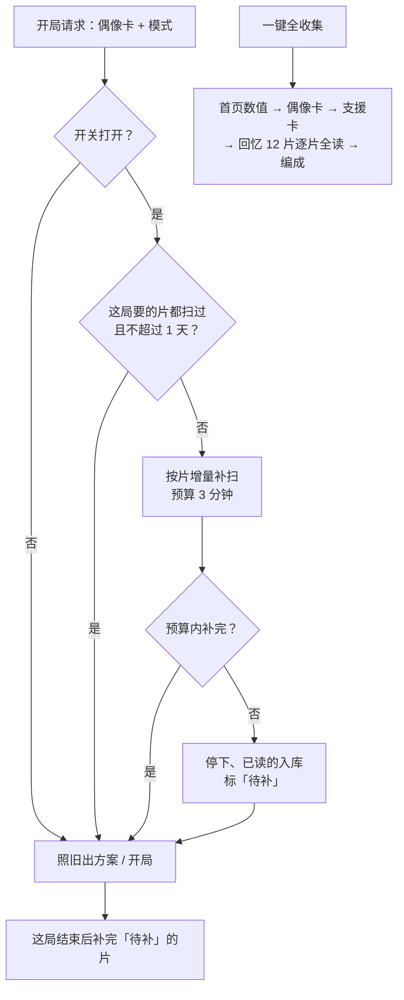

# 资料库扫描：按流派 / 模式分片补全，加一键全收集（设计）

状态：2026-11-26 03:09 批准（用户 5 分钟未回复，监督会话 db42bed 按 GOAL §4 按推荐代为批准）。总账编号 A17。

和 G0「开局前自动挑空白编成位并写编成」（分支 `feat_matto_auto_formation_slot`，`hiro.runtime.prepare_start` 包在开局任务外面）都在开局前那一段：5.6 的开局前补扫等 G0 合入后接到 `prepare_start` 这一层，不另开入口。

## 1. 为什么做

初星助手的回忆扫描每次都全量读：405 份要 30–39 分钟，哪怕只新拿了 1 份回忆。所以玩家不愿意重扫，资料库总是旧的；出编成方案时库存和游戏对不上，开局就被核对挡下（11-26「用花海咲季打一把初」就是这样停下的）。

用户的要求：11-24「回忆库存按时间排序、快速补上新数据」；11-26「分流派 / 模式逐步去补全，同时支持一键全收集」。

11-26 在本机复核时还发现，扫到的回忆数据本身有两处错误：属性带偏移，14 份被误标成可疑（见第 3 节）。不先修好这两处，分片和增量都没法做对。

## 2. 目标、不做的、不能变成的

| 目标 | 不做 | 不能变成 |
|---|---|---|
| • 回忆按「片」扫：一片 = 一个流派（プラン）× 一个获得模式（プロデュース），最多 12 片 • 片内按「入手」从新到旧增量读，碰到已有的就停 • 开局前自动补这局要用的片（开关，缺省关） • 一键全收集：5 种扫描按顺序做完，回忆 12 片全读 • 回忆属性存回忆本身的数值；修掉可疑误报；顺带给每格读法提速 | • 偶像卡、支援卡、编成的分片和增量（照旧全量） • 能力文字的 OCR 降噪（记下，之后看） • Windows / DMM 上的实机验收（这次只验 Mac） | • 扫描改了游戏里的东西：点到「決定」、换了编成、筛选排序没恢复 • 开局被扫描卡住：超过预算还在等 • 增量把旧数据当成新的重复记，或者把新回忆当成旧的漏掉 |

## 3. 现状和 11-26 复核发现

### 实测耗时（Mac 账号 2）

| 扫描 | 条数 | 耗时 | 每条 |
|---|---|---|---|
| 首页数值 | 1 | 2–17 秒 | — |
| 偶像卡 | 74 | 5 分 12 秒 | 4.2 秒 |
| 支援卡 | 116 | 1 分 51 秒 | 1.0 秒 |
| 回忆 | 405 | 30 分 29 秒（11-25）/ 39 分 14 秒（11-26） | 4.5–5.8 秒 |
| 编成 | 40 | 1 分 57 秒 | 2.9 秒 |

截图一次 0.04 秒，整屏 OCR 一次 0.38 秒。慢在每格的固定流程：点格子、等详情栏刷新、翻到详情第 2 页、再翻回第 1 页，共 4 次整屏 OCR（`src/hiro/produce/memory_picker.py` 的 `select_checked` / `read_selected`）。每页只多读 1 行，滑动步子偏小，原因没查。

### 复核发现（11-26 02:03–02:49，和 11-25 那次逐格对比）

| 发现 | 证据 | 这次怎么处理 |
|---|---|---|
| 回忆属性带常数偏移：选择页顶栏是「换进正在编辑的编成后」的合计，混着编成里其余几格 | 两次扫描 405 格技能卡全一样，Vo / Da / Vi 全部差同一组 5 / 28 / 80 | 修（5.3） |
| 14 格「点了详情没刷新」是误报：相邻两格详情栏太像，像素变化没过阈值 | 两次都是同样 14 格；读到的内容和上一格不同 | 修（5.5）。被标可疑的回忆出方案时不参与挑选 |
| 偶像卡「【一つ踏み出した先に】葛城リーリヤ」OCR 读成「ーつ」，对不上编号 | 11-25 手工修过，11-26 重扫又没了 | 修（5.9） |
| 回忆技能卡「楽観的」读成「楽観」 | 2 格，两次都一样 | 修（5.9） |
| 能力文字 OCR 噪声：图标读成「ぐ」「→」，混进「発動不可」角标 | 规整后只有 193 / 405 格两次一致 | 不修；增量比对不靠整段能力文字（5.2） |
| 同一格的缩略图指纹两次扫描对不上 | 1 / 405 一致 | 不能用来跨次认回忆（5.2） |

游戏的「ソート・フィルタ」弹窗（截图在 `~/github/digital-hiro/.temp/filter-grid.png`）：筛选有アイドル、プロデュース用スキルカードのプラン（共通 / センス / ロジック / アノマリー）、スキルカードタイプ、メモリーアビリティ、プロデュース（定期公演『初』/ NEXT IDOL AUDITION / Hatsuboshi IDOL FESTIVAL）、保護済み、評価、タグ；排序有「入手」（`memory_select.py` 已经用 OCR 点过）。

## 4. 已定的决定

| # | 决定 | 谁定的 |
|---|---|---|
| D1 | 回忆按入手时间排序，快速补上新数据 | 用户 11-24 |
| D2 | 分流派 / 模式逐步补全，同时支持一键全收集 | 用户 11-26 |
| D3 | 片 = 流派 × 获得模式（プラン × プロデュース，最多 12 片） | 监督 db42bed 按 GOAL §4 代为拍板（推荐项），11-26 02:57 |
| D4 | 开局前自动补这局要用的片：片没扫过或超过 1 天，就先增量补扫再出方案。按 GOAL §4「改变缺省行为的加开关、缺省关」，做成开关、缺省关 | 同上 |
| D5 | 开局前最多等 3 分钟，超过就用旧数据开局、事后补。监督的消息里写的是 1 分钟，但 GOAL §4 规定代为拍板只能选推荐项，推荐项是 3 分钟，这里按 3 分钟写，已告知监督 | 同上（待用户确认 1 还是 3） |
| D6 | 增量：连续 3 格和资料库已有的一样就停；一键全收集时全读 | 同上 |
| D7 | 一键全收集扫 5 种（首页数值 → 偶像卡 → 支援卡 → 回忆 → 编成）；入口是资料库「扫描」页顶部按钮和对话「/全收集」；首次进入的自动扫描也改走它 | 同上 |
| D8 | 这次只给回忆做分片和增量 | 同上 |
| D9 | 「没做成」的标准：日常增量补扫开局前超过预算；一键全收集中途出错要人接手；扫完抽查 20 格和游戏对不上；开局仍因库存旧被编成方案挡住 | 监督代填（第 7 题是开放题，没有推荐项） |
| D10 | 扫描只读：不点「決定」、不改编成；扫完把回忆列表的筛选和排序恢复成扫描前的样子 | 我的决定 |
| D11 | 回忆存它自己的属性（5.3）；资料库记下每片是从哪个编成进去扫的 | 我的决定 |
| D12 | 一键全收集的回忆部分 = 12 片逐片全读，不再做不带筛选的整表扫描，这样每份回忆都知道自己属于哪一片 | 我的决定 |
| D13 | 改动只进开源仓库 hiro-gakumas-hero，分支 `feat_matto_scan_slices`，提 PR 合 main | 我的决定 |

## 5. 设计

### 5.1 片和覆盖记录

- 片的键：`plan`（common / sense / logic / anomaly）×`produce`（hajime / nia / hif），共 12 片。
- 资料库新增「片覆盖」记录，按账号分开：片键、最近一次扫描时间、这次是增量还是全读、是否完整、从哪个编成进去的、读了几格、新增几格。
- 每条回忆记下它所在的片。片内全读完成时，这一片的回忆整体替换成这次读到的（能发现卖掉、删掉的）；增量只追加新的。
- 出编成方案读的回忆库存 = 各片合并。旧的整表扫描快照照样能读；一键全收集或者某片第一次全读之后，这一片改用新数据。
- 这局要用的片：偶像卡的流派 + 共通，各 × 3 个模式，共 6 片。

### 5.2 认出「已有的回忆」

增量补扫靠认出资料库里已经有的回忆才能停。比对用「回忆签名」：技能卡编号 + 强化等级 + 回忆本身的四项属性 + 能力摘要（每条能力规整后只取属性词和数字，比如「Da SP レッスン 55% 消費体力減少 2」）。11-26 的数据里，只用前三项时 405 份有 38 组撞车（86 份），所以要加能力摘要；整段能力文字两次扫描只有 193 份一致，不能直接比；缩略图指纹跨次不稳定，不用。

停止规则（D6）：从最新一格往下读，连续 3 格签名都在资料库这一片里，就停。签名有重复的（同卡同属性同能力），按出现次数比对：资料库这一片里这个签名有几份，就允许被「认出」几次。

### 5.3 回忆属性去偏移

先上机弄清顶栏合计怎么算（第一个任务，用实机做）：在同一个编成里分别选几份已知的回忆，看顶栏和回忆详情的关系。然后按查到的算法扣掉编成里其余几格的贡献。

退路：如果查不清，就固定从同一个编成号进去扫（资料库记下编成号），同时用「编成详细」里读到的其余几格数值算出偏移再扣掉。两条都走不通时停下来报告，不做分片。

### 5.4 一片怎么扫

1. 从首页进编成菜单，打开回忆选择页（沿用 `formation_menu`）。
2. 点排序按钮，记下当前的排序和筛选（用于恢复），切到「入手」排序，在「フィルタ」页先全解除，再勾这一片的プラン和プロデュース，决定。
3. 从顶部读（增量按 5.2 停；全读读到底）。
4. 恢复扫描前的排序和筛选，点キャンセル退出选择页。恢复失败要在任务结果里写明。

一次扫多片时，筛选在选择页里切换，不退回首页。

### 5.5 每格读法提速，修掉可疑误报

- 不再翻回详情第 1 页：下一格按详情栏停在第几页决定先读哪页（游戏换格子后停在哪页要上机确认）。
- OCR 只识别详情栏区域；「选择页还开着」每页确认一次，读格子时只在出异常时再确认。
- 查清每页只前进 1 行的原因，改成一次滑 2 行。
- 「详情没刷新」的判定：像素变化没过阈值，但读到的签名和上一格不同，就算刷新了。
- 目标：每格从 5.5 秒左右降到 3 秒以内，用实机计时验证。

### 5.6 开局前自动补

- 开关 `HIRO_SCAN_BEFORE_START`（初星助手设置里也有），缺省关。
- 打开时：开局任务在核对编成之前，检查这局要的 6 片；没扫过或超过 1 天的按 5.2 增量补扫，总预算 3 分钟（D5）。
- 超预算：停下，已读的入库，没补完的片标「待补」，用现有数据继续出方案、开局；这局结束后自动补完「待补」的片。
- 补扫是读操作，不单独弹确认卡；开局那张确认卡里写明「开局前会先补扫回忆，最多 3 分钟」。

### 5.7 一键全收集

- 一个任务按顺序做 5 步：首页数值 → 偶像卡 → 支援卡 → 回忆（12 片逐片全读）→ 编成。
- 入口：资料库「扫描」页顶部的主按钮；对话里说「/全收集」；首次进入时的自动扫描（替换 `shell/perm.go` 的 FirstScan 三连扫）。
- 一张确认卡列出 5 步和预计时间；中途可以停，已完成的步骤和片照样入库；某一步出错就停下，在结果里写明卡在哪一步。
- 进度在驾驶舱里显示「第几步 / 回忆第几片 / 已读几格」。

### 5.8 资料库界面

- 回忆信息卡和资料库页的回忆栏，加一行片覆盖：12 片里扫过几片、最旧的是哪天、有没有「待补」。
- 「扫描」页：顶部「一键全收集」主按钮；原来的单项扫描按钮保留，回忆按钮改成「补扫新回忆」（增量，全部 12 片）。

### 5.9 两处卡名小修复

- 偶像卡卡名匹配也把「一 / ー」当成同一个字（P 卡已经这样做了）。
- 技能卡卡名精确匹配不到时，如果读到的字是唯一一张卡名的前缀（至少 2 个字），就认成那张。
- 入库时对旧数据再对一次，不用重扫。

### 5.10 审稿后补充的决定（都是我的决定）

交给实现前，让一个没参与讨论的审稿人照着这份文档列过计划，他提的问题按下面处理（原文在 `~/github/digital-hiro/.temp/scan-verify-20261126/builder-check.md`）。

| # | 问题 | 决定 |
|---|---|---|
| D14 | 开局前补扫插在哪，补完要不要重出方案、重写编成 | 补扫插在 `cmd_run` 的开局预检之前（11-26 挡人的是预检里的库存新鲜度检查 `_check_memory_freshness`）。补完后只重跑预检：方案选的回忆都还在、库存够新，就照常开局。不自动重出方案、不自动写编成（写编成会改游戏，要玩家点确认）；方案里的回忆不在了，就停下说明要重出方案。新鲜度检查改成看这局要的 6 片的覆盖时间。 |
| D15 | 分片后方案里存的回忆位置指什么 | 方案里每份回忆存片键 + 签名（5.2），不再依赖整表行号。写编成时按片键套上同样的筛选和「入手」排序，在列表里按签名找。旧方案（存的是整表行号）照旧按原来的方式找。 |
| D16 | 旧整表快照没有片标记，怎么和新片合并 | 不混用。这局要的 6 片都全读过，就用片数据；否则整套用旧整表快照。一键全收集完成后，旧整表不再使用（保留，不删）。 |
| D17 | 12 片合起来是不是整表；有没有落在片外、或者同时属于两片的回忆 | 第一个实机任务里一起查：12 片的份数相加和整表份数对比，再看同一份会不会出现在两片里。对不上时，一键全收集在 12 片之后再加一片「片外」：不带筛选全读一遍，把签名不在任何片里的回忆记进去。同一份出现在两片就按签名去重，记在第一个读到它的片里。 |
| D18 | 「入手」排序不稳、回忆被强化后签名变了 | 增量只追加新签名；强化过的回忆会被当成新的追加一次，旧的那条留到下次全读这一片时才去掉。出方案时同一片里签名只差强化等级的两条，只算一份。 |
| D19 | 去偏移两条路都走不通怎么办 | 先交付不依赖它的部分：5.5 提速和可疑误报、5.9 卡名修复、5.7 一键全收集（回忆部分退回现在的整表全读）。分片、增量、开局前自动补停下，在 PR 里写明卡在哪。 |
| D20 | 全收集第 5 步「编成」从哪个编成号进 | 沿用现有的编成扫描（`scan-formations`，只读，11-25 实测 2 分钟读 40 个编成），不新选编成号。回忆扫描「从哪个编成进去」记的是打开回忆选择页时游戏当前显示的那个编成号。 |

## 6. 留给实现时定的

- 顶栏合计的具体算法、扣偏移的做法（5.3 的第一个任务）。
- 能力摘要的规整规则，以及签名撞车时的细节。
- 筛选弹窗里各复选框的定位方式（OCR 找字优先，固定坐标兜底）。
- 片覆盖记录放进现有 `snapshots` 表的方式（新表还是 meta）。
- 每格读法的几项提速各自值不值得：按实机计时取舍。

## 7. 怎么算做完

- [ ] 离线测试：签名比对、停止规则、片合并、去偏移、恢复筛选、卡名修复，各有用例；全量 pytest 和 Go 测试通过
- [ ] 实机（Mac 账号 2）：一键全收集从首页开始走完 5 步不用人接手，回忆 405 份左右全部读到、没有漏行
- [ ] 实机：全收集之后马上再补扫一次，每片 1 分钟内停下、新增 0 份
- [ ] 实机：抽查 20 格回忆，属性、技能卡和游戏详情页一致（属性是回忆本身的数值）
- [ ] 实机：扫描前后回忆列表的排序和筛选一致；编成没变
- [ ] 实机：打开开关后「用某偶像打一把初」，开局前补扫不超过 3 分钟，开局不被库存问题挡下
- [ ] 可疑格从 16 降到只剩真读不出的

## 8. 用到的材料

- 本文档：`feat_matto_scan_slices/.ryugi/artifacts/document/scan-slices/doc.xml`，批准后另存为 `docs/ryugi/specs/2026-11-26-scan-slices-design.md`。
- 复核用的两次扫描：`~/github/digital-hiro/.temp/hatsuboshi-20261125/home/jobs/20261125-194858-0945`（11-25）和 `20261126-020939-a616`（11-26）的 `out.json` 与 `calib/` 截图；核对脚本 `~/github/digital-hiro/.temp/scan-verify-20261126/check.py`。
- 筛选弹窗截图：`~/github/digital-hiro/.temp/filter-grid.png`。
- 监督总账：`~/github/digital-hiro/.temp/console-goal-20261126/ledger.md` 的 A17。
